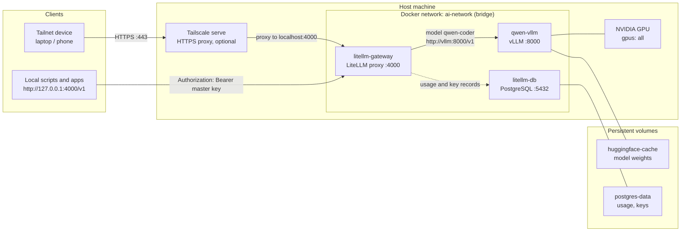

# System Design — AI Inference Stack

This document describes the architecture as implemented in this repository
(`docker-compose.yml`, `litellm-config.yaml`, `Makefile`,
`test-local.sh`, `enable-private-access.sh`). Runtime numbers marked
**[observed]** were measured on the reference machine (single RTX 4090,
2026-11-18) and are not guaranteed by the configuration.

## Overview

A single-machine stack that serves a local LLM through an OpenAI-compatible
gateway. Docker Compose runs three services on one bridge network; only the
gateway port is published to the host, and only on loopback. Remote clients
never touch Docker networking directly — they arrive through Tailscale's
HTTPS proxy on the host.

## Components

| Service (compose) | Container | Image | Responsibility |
|---|---|---|---|
| `vllm` | `qwen-vllm` | `vllm/vllm-openai:latest` | Serves the model `stelterlab/Qwen3-Coder-30B-A3B-Instruct-AWQ` under the name `qwen-coder` (32K context, `--gpu-memory-utilization 0.90`, `--max-num-seqs 4`, `--dtype auto`). Uses all GPUs (`gpus: all`) and host IPC. |
| `litellm` | `litellm-gateway` | `ghcr.io/berriai/litellm:main-stable` | The only entry point. Terminates API auth (master key), routes `qwen-coder` to vLLM, applies `request_timeout: 180` and `num_retries: 2` (from `litellm-config.yaml`), and records usage/keys in PostgreSQL. Starts only after `vllm` is started and `db` is healthy. |
| `db` | `litellm-db` | `postgres:16-alpine` | PostgreSQL for LiteLLM's database features (web dashboard, usage history, virtual keys). Credentials come from `.env`; health-checked with `pg_isready`. |

Host-level pieces (outside Compose):

- **Tailscale** (`enable-private-access.sh`): `sudo tailscale serve --bg 4000`
  proxies HTTPS on the machine's tailnet hostname to `localhost:4000`.
- **NVIDIA driver + Container Toolkit**: required for `gpus: all`;
  `make check-gpu` verifies both.

## Architecture diagram

## Request flow

1. A client sends an OpenAI-style request to
   `http://127.0.0.1:4000/v1/chat/completions` (local) or
   `https://<machine-name>.<tailnet>.ts.net/v1/...` (remote, proxied by
   `tailscale serve` to host port 4000).
2. LiteLLM validates the `Authorization: Bearer <LITELLM_MASTER_KEY>` header
   against the master key referenced in `litellm-config.yaml`
   (`os.environ/LITELLM_MASTER_KEY`, supplied via `.env`).
3. LiteLLM maps the requested model name `qwen-coder` to
   `hosted_vllm/qwen-coder` and forwards the request to
   `http://vllm:8000/v1` inside the Docker network (Docker DNS resolves the
   service name `vllm`).
4. vLLM runs inference on the GPU and streams the response back through the
   same path. Requests exceeding `request_timeout: 180` are retried up to
   `num_retries: 2` times by LiteLLM.
5. Usage metadata is written to PostgreSQL for the dashboard and virtual-key
   accounting.

Startup ordering: `db` must pass its healthcheck before `litellm` starts;
`vllm` only needs to be started (the model itself keeps loading for minutes
afterwards **[observed]** — the gateway returns 5xx for model requests until
loading completes).

## Ports, networks, and storage

| Port | Bound to | Reachable from |
|---|---|---|
| 4000 (LiteLLM) | published as `127.0.0.1:4000:4000` | Host loopback only — not the LAN, not the internet |
| 8000 (vLLM) | `expose` only (no publish) | Other containers on `ai-network` only |
| 5432 (PostgreSQL) | not published at all | Other containers on `ai-network` only |
| 443 (Tailscale) | `tailscale serve` on the host | Tailnet devices only, with valid TLS |

- **Network:** one user-defined bridge network, `ai-network`. Service names
  (`vllm`, `litellm`, `db`) are the in-network hostnames.
- **Volumes:** `huggingface-cache` (model weights — survives `make clean`,
  deleted by `make reset`) and `postgres-data` (usage/key data, same rules).
- **Bind mount:** `./litellm-config.yaml` → `/app/config.yaml:ro` inside the
  gateway container. `.env` is loaded via `env_file` (never mounted).

## External dependencies

| Dependency | Needed for | Notes |
|---|---|---|
| Hugging Face Hub | One-time model download by vLLM | `huggingface-cache` volume avoids re-downloads |
| Docker Hub / GHCR | Images: `vllm/vllm-openai`, `postgres`, `nvidia/cuda` (only for `make check-gpu`), `litellm` from GHCR | Tags `latest` / `main-stable` are **unpinned** — `make update` can change behavior |
| NVIDIA driver + Container Toolkit | GPU access from Docker | Verified by `make check-gpu` |
| Tailscale login | Remote access only | The stack itself works fully offline after the first download |

## Authentication and private access

Defense in depth, outermost first:

1. **Network reach:** the only published port is loopback-only. Remote
   clients must be tailnet members; `tailscale serve` adds TLS on that path.
2. **Gateway auth:** every `/v1` request needs the master key
   (`LITELLM_MASTER_KEY`, generated by `make setup` via `openssl rand -hex 32`).
   The dashboard at `/ui/` (upstream LiteLLM feature) logs in with username
   `admin` and the master key as password.
3. **Internal services:** vLLM runs **without** an API key
   (`api_key: none` in `litellm-config.yaml`) — it is protected purely by
   network isolation. PostgreSQL has a password (from `.env`) and is also
   network-isolated.

## Deployment assumptions and limitations

- **Single machine, single-GPU-class deployment.** `gpus: all` targets one
  host; there is no multi-node or multi-GPU sharding configuration.
- **GPU size:** no minimum is stated in the repo. The current configuration
  (30B AWQ weights + 32K KV cache at 0.90 utilization) fills a 24 GiB GPU
  **[observed ~23 GiB in use]** — smaller GPUs require lowering
  `--max-model-len` or `--gpu-memory-utilization`, or choosing a smaller model.
- **Concurrency:** `--max-num-seqs 4` — up to 4 sequences are batched
  simultaneously; additional requests queue.
- **Context:** 32,768 tokens per request (prompt + completion combined).
- **Known setup gap:** `make setup` generates only `LITELLM_MASTER_KEY`;
  `POSTGRES_PASSWORD` and `DATABASE_URL` must be added manually (see README).
  On a fresh clone, `make up` cannot start `db` without them.
- **Unpinned images:** `vllm/vllm-openai:latest` and
  `ghcr.io/berriai/litellm:main-stable` move with upstream; pin digests for
  reproducibility.
- **Persistence semantics:** `make clean` keeps volumes; `make reset`
  deletes them (including the ~17 GB model cache **[observed]**).
- **Recovery behavior:** all services use `restart: unless-stopped`, so they
  return after a reboot — but the model reloads from disk into the GPU,
  which takes minutes **[observed ~3 min]** and briefly leaves the gateway
  unable to serve model requests.
- **Local endpoint is plain HTTP.** Acceptable because it never leaves the
  machine; the remote path gets TLS from Tailscale.

## What cannot be determined from this repository

- Minimum GPU memory requirement (no hardware statement in the repo).
- Exact model artifact size and load time (set by the upstream Hugging Face
  revision; figures in this document are observations).
- The remote HTTPS hostname (depends on this machine's Tailscale identity;
  obtain from `make remote-status`).
- LiteLLM dashboard capabilities and their exact behavior (upstream image
  feature, not configured here beyond enabling its database).
- Performance figures (e.g., tokens/sec) — depend on hardware and workload;
  measured values belong in `STEP_LOG.md`, not in design docs.
